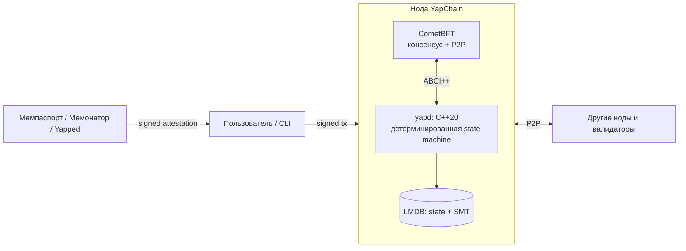

# YapChain

> **Экономика настоящая. Ценность сомнительная.**

YapChain — open-source блокчейн мемной экосистемы с собственной валютой **YAP**.
Назначение абсурдно, исполнение — нет: настоящие подписи Ed25519, независимые ноды,
проверяемая история, BFT-консенсус и детерминированная state machine на C++20.

## Что это

- **Account-based ledger**: балансы и nonce у адресов, без UTXO и без VM.
- **Нативная валюта YAP**: genesis-распределение и эмиссия за блоки; минимальная единица — `yip` (1 YAP = 1 000 000 yip).
- **Permissioned BFT**: 4 известных валидатора, выдерживает 1 византийского.
- **Встроенные операции** вместо смарт-контрактов: `Transfer`, `Burn`, `ClaimAchievement`.
- **Мемные достижения**: внешние приложения (Мемпаспорт, Мемонатор, Yapped) выдают подписанные аттестации,
  пользователь сам подаёт claim и получает YAP из пула наград. Без YapChain эти приложения работают как прежде.
- **Адреса** вида `tyap1…` (Bech32m).

## Статус

- **M0** — архитектура и протокол (ревизия r2) — завершён.
- **M1.1 Foundation** — реализован: сборка, зафиксированные зависимости, базовые типы и checked-арифметика,
  YCS, SHA-256 и tagged hash, Ed25519, Bech32m и адреса, независимые test vectors.
- M1.2–M1.4 (ledger, хранилище, dev-chain) — впереди, см. [docs/roadmap.md](docs/roadmap.md).

Транзакций, state machine и сети пока нет.

## Сборка и тесты

Требования: Linux x86_64 или aarch64, CMake ≥ 3.25, Ninja, make, GCC ≥ 13 или Clang ≥ 17, Python 3 (для векторов).
Зависимости (libsodium 1.0.22, Catch2 3.16.1, nlohmann/json 3.12.0) скачиваются CMake и проверяются по SHA-256.

```sh
cmake --preset debug   && cmake --build --preset debug   && ctest --preset debug
cmake --preset asan    && cmake --build --preset asan    && ctest --preset asan     # ASan + UBSan
cmake --preset release && cmake --build --preset release && ctest --preset release
python3 -I tools/refgen/refgen.py --out test-vectors    # перегенерировать эталонные векторы
```

## Документация

| Документ | О чём |
|---|---|
| [docs/architecture.md](docs/architecture.md) | Модули, зависимости, CMake, библиотеки |
| [docs/protocol.md](docs/protocol.md) | Сериализация, адреса, транзакции, state, Merkle, исполнение блоков |
| [docs/consensus.md](docs/consensus.md) | Выбор BFT-движка, интеграция, восстановление после сбоев |
| [docs/economics.md](docs/economics.md) | Токеномика закрытого testnet |
| [docs/attestations.md](docs/attestations.md) | Подписанные аттестации и начисление наград |
| [docs/threat-model.md](docs/threat-model.md) | Модель угроз |
| [docs/roadmap.md](docs/roadmap.md) | Этапы, scope и тест-план M1 |
| [docs/adr/](docs/adr/) | Архитектурные решения (ADR) |

В документах статусы решений помечены так:
**DECIDED** — утверждено, **PROPOSED** — предлагается, **OPEN** — требует решения.

## Архитектура в одной схеме



## Лицензия

[Apache-2.0](LICENSE).
