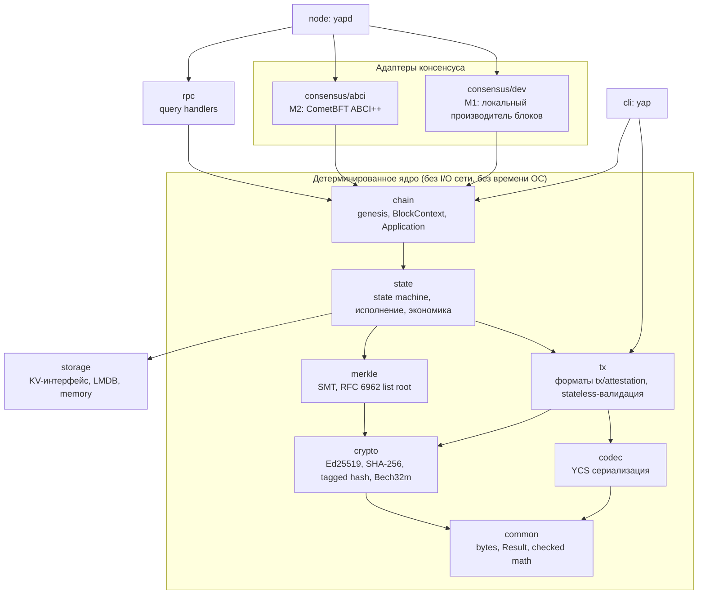
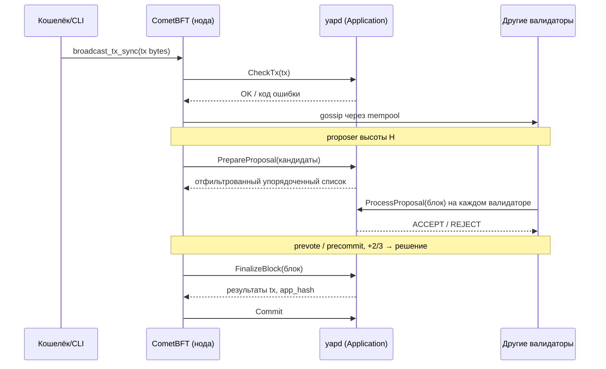
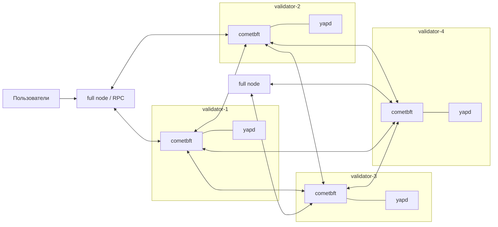

# Архитектура YapChain

Статусы: **DECIDED** — утверждено, **PROPOSED** — предлагается, **OPEN** — требует решения.

## 1. Исходные решения (DECIDED)

| Решение | Значение |
|---|---|
| Язык ядра | C++23 (ADR-0030; до M2.6.2 — C++20) |
| Модель ledger | account-based |
| Валюта | YAP, genesis + эмиссия за блоки |
| Консенсус | permissioned BFT, 4 валидатора на старте |
| Адреса | собственные криптографические адреса |
| Логика | встроенные операции, без VM и смарт-контрактов |
| Внешние приложения | подписанные аттестации, интеграция необязательна |
| Сеть | независимая P2P-сеть |
| Explorer, веб-кошелёк | будущие этапы |
| Консенсус-движок и P2P | CometBFT отдельным процессом (ADR-0002, ADR-0009, ADR-0012) |
| Governance | multisig 3-of-5, после M1 (ADR-0013) |
| Лицензия | Apache-2.0 (ADR-0012) |
| Платформы нод | Linux x86_64 и Linux aarch64 (ADR-0012) |

## 2. Главный архитектурный принцип

**Консенсус упорядочивает байты, state machine их исполняет.** (DECIDED, см. [ADR-0002](adr/0002-consensus-engine.md), [ADR-0012](adr/0012-owner-decisions-after-m0.md))

- Консенсус-движок решает только, *какой* список транзакций в *каком* порядке составляет блок на высоте `H`,
  и гарантирует, что все честные ноды получат один и тот же список.
- State machine — чистая детерминированная функция
  `(state_{H-1}, BlockContext_H) → (state_H, results_H, state_root_H)`.
  Она ничего не знает о сети, голосованиях и таймаутах.
- Между ними стоит узкий интерфейс `Application` (раздел 4), который реализуют все адаптеры консенсуса.

Поэтому в M1 ядро можно разработать и полностью протестировать без сети и без BFT,
а в M2 подключить CometBFT, не меняя state machine.

## 3. Модули



### 3.1 common
Типы `Bytes`, `Hash32`, `AccountId`, `Result<T, Error>` (собственный `std::expected`-подобный тип: `std::expected`
недоступен в поддерживаемых Clang 17/18 с libstdc++, ADR-0030), checked-арифметика
`checked_add/sub/mul` для `uint64_t`, `mul_div_floor(a, b, c)` через `unsigned __int128`.

### 3.2 codec
YCS (YapChain Canonical Serialization), спецификация в [protocol.md §3](protocol.md#3-каноническая-сериализация-ycs).
Encoder и строгий decoder с лимитами длин. Свойство: `encode(decode(b)) == b` для любого принятого `b`.

### 3.3 crypto
- Ed25519 (libsodium): генерация ключей, подпись, строгая проверка.
- SHA-256 и tagged hash `H_tag`.
- Bech32m (собственная реализация по BIP-350, ~150 строк).
- Keystore: шифрование seed (Argon2id + XChaCha20-Poly1305 из libsodium).

### 3.4 tx
Структуры `TxBody`, `SignedTx`, `Attestation`, `SignedAttestation`, их кодирование, `tx_id`,
stateless-валидация (размер, версия, chain_id, подпись, лимиты полей).

### 3.5 merkle
- Sparse Merkle Tree (SMT) для state root ([protocol.md §8](protocol.md#8-commitments-merkle-roots)).
- RFC 6962 Merkle root для списка транзакций в dev-блоках.

### 3.6 state
State machine: аккаунты, глобальное состояние `ChainState`, параметры, реестр эмитентов,
счётчики claim'ов, nullifier'ы. Исполняет транзакции, начисляет эмиссию, считает state root.
Работает поверх абстрактного `KvStore` и буфера изменений (overlay): изменения блока копятся в памяти
и записываются одной атомарной транзакцией только в `commit()`.

### 3.7 storage
Интерфейс `KvStore` (таблицы `state`, `smt`, `results`, `meta`; точечное чтение, упорядоченный обход,
атомарный `WriteBatch`) и две реализации: `MemoryStore` и `LmdbStore` (DECIDED, LMDB 0.9.36,
[ADR-0007](adr/0007-storage-lmdb.md), [ADR-0022](adr/0022-storage-layout.md)). Узлы SMT хранятся отдельно от
консенсусного state и обновляются инкрементально ([ADR-0023](adr/0023-persistent-smt.md)).
Хранит: листья state, узлы SMT (content-addressed), метаданные (`last_height`, `last_state_root`),
результаты транзакций по высоте (для запросов). Блоки хранит **консенсус-движок** (CometBFT blockstore);
в dev-режиме — отдельный журнал dev-блоков.

### 3.8 consensus adapter
- `consensus/dev` (M1): однопроцессный производитель блоков для тестов и разработки. Формирует `DevBlock`
  из файла/очереди транзакций, подписывает dev-ключом, умеет переигрывать цепочку блоков.
  **Не является сетью** и не используется в testnet.
- `consensus/abci` (M2): ABCI++ сервер для CometBFT (протокол поверх Unix socket/TCP, protobuf).

### 3.9 P2P
DECIDED ([ADR-0009](adr/0009-p2p-via-cometbft.md), [ADR-0012](adr/0012-owner-decisions-after-m0.md)): собственный P2P-стек **не пишем**.
Сеть YapChain независима (собственные ноды, seed-ноды, genesis), но транспорт, gossip блоков, голосов
и mempool обеспечивает CometBFT. Модуль P2P в нашем репозитории — это конфигурация и шаблоны
развёртывания (persistent peers, sentry-топология, отключённый PEX на валидаторах).

### 3.10 RPC
PROPOSED: на M2–M4 публичный API — это CometBFT RPC (`broadcast_tx_sync`, `block`, `tx`, `status`)
плюс наши query-обработчики через `abci_query` (пути `/account/<addr>`, `/supply`, `/issuer/<id>`, `/params`).
Отдельный HTTP/JSON-шлюз для explorer и кошелька — на этапе M5, если понадобится.

### 3.11 CLI (`yap`)
- `yap keys new|show|import|export` — keystore.
- `yap addr <pubkey>` — вычисление адреса.
- `yap tx transfer|burn|claim --build|--sign|--inspect` — оффлайн сборка и подпись.
- `yap genesis validate|hash` — проверка genesis.
- `yap dev produce|replay|state-root` — dev-адаптер (M1).
- `yap query …`, `yap tx broadcast` — через RPC (M2+).

### 3.12 node (`yapd`)
Процесс приложения: загрузка genesis, открытие хранилища, запуск выбранного адаптера (`--mode dev|abci`).

## 4. Интерфейс Application (PROPOSED)

```cpp
namespace yap::chain {

struct BlockContext {                       // нормативно: protocol.md §9.1
    std::string chain_id;
    uint64_t height;
    uint64_t time_ms;                       // unix ms, из консенсуса
    std::array<uint8_t, 20> proposer;       // consensus address
    std::vector<CommitVote> last_commit;    // голоса за H−1: address, power, flag; на высоте 1 пуст
    std::vector<Misbehavior> misbehavior;   // evidence от консенсуса
    std::vector<Bytes> txs;                 // в порядке блока
};

struct TxResult   { uint32_t code; std::string log; std::vector<Event> events; };
struct BlockResult{ std::vector<TxResult> tx_results; Hash32 state_root; };

class Application {
public:
    virtual Info         info() const = 0;                       // last_height, last_state_root
    virtual void         init_chain(const Genesis&) = 0;
    virtual CheckResult  check_tx(ByteView tx, CheckMode) = 0;   // mempool, отдельный check-state
    virtual std::vector<Bytes> prepare_proposal(const BlockContext&, std::vector<Bytes> candidates,
                                                uint64_t max_bytes) = 0;
    virtual bool         process_proposal(const BlockContext&) = 0;   // строгая проверка блока
    virtual BlockResult  finalize_block(const BlockContext&) = 0;     // исполнение, без записи на диск
    virtual void         commit() = 0;                                // атомарная запись
    virtual QueryResult  query(std::string_view path, ByteView data, uint64_t height) const = 0;
};

}
```

Отображение на ABCI++: `Info`, `InitChain`, `CheckTx`, `PrepareProposal`, `ProcessProposal`,
`FinalizeBlock`, `Commit`, `Query` — один к одному. Snapshot-методы (state sync) не реализуются до M5.

## 5. Жизненный цикл транзакции



## 6. Правила детерминизма (обязательны для `core`)

1. Никакой плавающей точки в коде, влияющем на state.
2. Только целые фиксированной ширины (`uint8_t…uint64_t`, `unsigned __int128` для промежуточных произведений).
   Переполнение — ошибка валидации, а не wrap-around. Знаковые типы в протокольных значениях не используются.
3. Никаких `std::unordered_map`/`std::hash` в порядке обхода, влияющем на результат; порядок — только
   явно специфицированный (порядок в блоке или сортировка по байтам).
4. Никакого системного времени, случайности, locale, переменных окружения внутри исполнения.
   Время — только `BlockContext.time_ms`.
5. Порядок байт в сериализации — явный (little-endian, YCS), не `memcpy` структур.
6. Нет UB: CI с ASan/UBSan; сравнение state root между GCC и Clang, x86_64 и aarch64 (DECIDED: обе платформы
   поддерживаются; CI использует нативные aarch64-раннеры GitHub `ubuntu-24.04-arm` — доступность для приватного
   репозитория проверить при подключении CI).
7. Ошибка в данных транзакции никогда не приводит к исключению/падению ноды — только к коду результата.
   Падение допустимо только при нарушении внутреннего инварианта или отказе хранилища (fail-stop лучше расхождения;
   классы ошибок — protocol.md §1.1).
8. Код результата tx — часть консенсуса (protocol.md §9.4); порядок проверок нормативен (protocol.md §6.2–6.3).
9. Каждая tx исполняется в своём overlay, ошибка не оставляет частичных записей (protocol.md §7.5).

## 7. Потоки и процессы

- PROPOSED: исполнение блока однопоточное. При 4 валидаторах и ожидаемой нагрузке testnet этого достаточно;
  при необходимости — параллельная проверка подписей в `CheckTx`/`ProcessProposal` без изменения семантики.
- Процессы на ноде: `cometbft` + `yapd`, связь по Unix socket. Падение любого процесса останавливает ноду;
  восстановление — через handshake ([consensus.md §6](consensus.md#6-восстановление-после-сбоев)).

## 8. Развёртывание закрытого testnet



Full node — тот же `cometbft + yapd` без ключа валидатора: хранит и проверяет всю историю,
переисполняет каждый блок, обслуживает RPC, не голосует и не получает наград.

## 9. Структура репозитория и CMake (PROPOSED)

```
YapChain/
├── CMakeLists.txt
├── CMakePresets.json          # debug, release, asan-ubsan, clang, gcc, fuzz
├── cmake/                     # Warnings.cmake, Sanitizers.cmake, Dependencies.cmake (URL + SHA-256)
├── src/
│   ├── common/   → yap_common   (static lib)
│   ├── codec/    → yap_codec
│   ├── crypto/   → yap_crypto
│   ├── tx/       → yap_tx
│   ├── merkle/   → yap_merkle
│   ├── storage/  → yap_storage
│   ├── state/    → yap_state
│   ├── chain/    → yap_chain
│   ├── consensus/dev/   → yap_consensus_dev
│   ├── consensus/abci/  → yap_consensus_abci   (M2, опция YAP_WITH_ABCI)
│   ├── rpc/      → yap_rpc
│   ├── node/     → yapd (executable)
│   └── cli/      → yap  (executable)
├── tests/
│   ├── unit/
│   ├── vectors/               # прогон test-vectors/*.json
│   ├── scenario/              # многоблочные сценарии, replay
│   └── fuzz/                  # libFuzzer: декодеры, Bech32m, исполнение
├── test-vectors/              # JSON, генерируются независимым reference-скриптом
├── tools/refgen/              # Python-генератор векторов (не часть ноды)
├── deploy/                    # конфиги CometBFT, docker compose localnet (M2)
└── docs/
```

Правила зависимостей: модули `core` не зависят от `storage`-реализаций (только от интерфейса),
от адаптеров консенсуса, RPC, сети и логгера (логирование — через абстрактный sink).
Компиляторы: GCC ≥ 13, Clang ≥ 17; `-Wall -Wextra -Wpedantic -Wconversion -Wsign-conversion -Werror` в CI.

## 10. Зависимости (PROPOSED)

| Библиотека | Где | Почему | Альтернативы и причина отказа |
|---|---|---|---|
| **libsodium** 1.0.22 (точный пин) | crypto | Аудированная, стабильная семантика строгой проверки Ed25519, SHA-256, Argon2id, AEAD, защищённая память — всё в одной библиотеке | OpenSSL 3: другая семантика проверки Ed25519 (риск расхождения), тяжелее; Monocypher: нет SHA-256 |
| **LMDB** | storage | Маленькая, ACID, crash-safe по устройству, без компакций и тюнинга | RocksDB: мощнее и с checksum'ами блоков, но тяжёлая сборка и много настроек ([ADR-0007](adr/0007-storage-lmdb.md)) |
| **CometBFT** (внешний процесс) | консенсус, P2P, mempool, blockstore | Зрелый Tendermint-BFT, ABCI++ ([ADR-0002](adr/0002-consensus-engine.md)) | см. [consensus.md](consensus.md) |
| **protobuf** | consensus/abci | Формат сообщений ABCI | — |
| **Asio** (standalone) | consensus/abci | Сокет-сервер ABCI | Boost.Asio — то же, но тянет Boost |
| **nlohmann/json** 3.12.0 | genesis, CLI, векторы | Удобство, JSON только на границах (не в консенсусных хешах) | — |
| **CLI11** | cli | Простой парсер аргументов | — |
| **spdlog** | node, cli | Логирование | — |
| **Catch2** 3.16.1 | тесты | Простые property-style тесты, генераторы | GoogleTest — равноценно |
| **libFuzzer** | fuzz | Встроен в Clang | — |
| Bech32m, YCS, SMT | свои | Малый объём кода, нужна точная спецификация, готовых поддерживаемых C++ библиотек с нужной семантикой нет | — |

Управление зависимостями (DECIDED в [ADR-0018](adr/0018-dependency-pinning.md), заменяет первоначальное
предложение vcpkg): каждая зависимость скачивается CMake по точному URL релиза и проверяется по SHA-256
(`FetchContent`/`ExternalProject`); libsodium собирается из исходников с фиксированными флагами. Системные копии
библиотек не используются.

## 11. Чего в архитектуре нет намеренно

- VM и пользовательских контрактов.
- Собственного BFT и собственного P2P-транспорта (обоснование — в ADR-0002, ADR-0009).
- Произвольного mint: новые YAP возникают только в genesis и в блочной эмиссии ([economics.md](economics.md)).
- Шардинга, light-client протоколов, state sync — до явной потребности.
