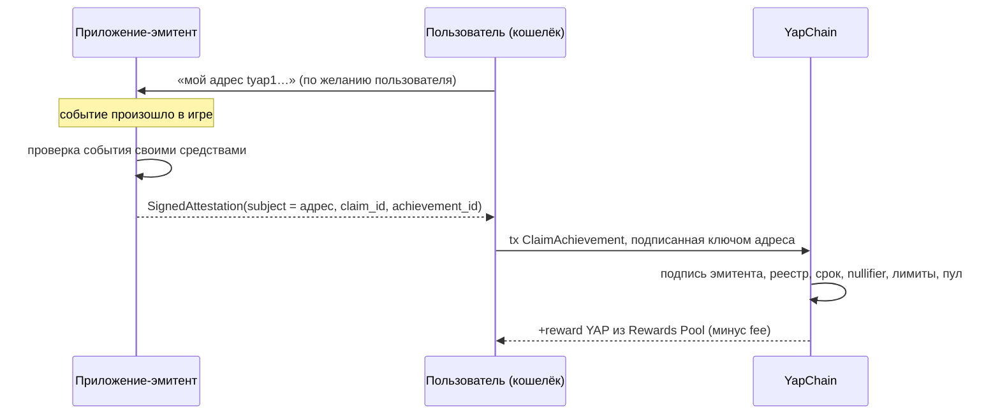

# Мемные достижения: подписанные аттестации

Статусы: **DECIDED** — утверждено, **PROPOSED** — предлагается, **OPEN** — требует решения.
Если не указано иное — **PROPOSED**.

## 1. Идея и границы доверия

Внешние приложения (Мемпаспорт, Мемонатор, Yapped) могут выдавать пользователям подписанные **аттестации** —
утверждения вида «по данным приложения X, с адресом Y произошло событие Z». Пользователь сам подаёт такую аттестацию
в сеть и получает YAP из Rewards Pool.

**DECIDED**: интеграция необязательна. Игры и приложения работают без YapChain; если сеть недоступна, аттестации
можно подать позже (в пределах срока действия). В обратную сторону YapChain ничего от приложений не требует.

Четыре разные вещи, которые нельзя смешивать:

| Что | Чем подтверждается | Что доказывает | Что **не** доказывает |
|---|---|---|---|
| Согласие пользователя | подпись tx `ClaimAchievement` ключом адреса | владелец адреса хочет получить награду и раскрыть факт достижения | что событие было |
| Утверждение эмитента | подпись аттестации ключом эмитента из реестра | зарегистрированный эмитент **заявил** о событии | что событие действительно произошло |
| Подтверждение события | вне цепи, ответственность эмитента | — | цепь не проверяет игровую логику |
| Начисление YAP | правила state machine: реестр, лимиты, nullifier, пул | награда выдана по правилам и не более лимитов | — |

Подпись приложения **не считается доказательством истинности** события. Поэтому протокол не доверяет эмитенту
больше, чем на величину его бюджета: скомпрометированный или нечестный эмитент может потратить не больше своего
лимита за эпоху, после чего его отключают.



## 2. Почему награда — перевод, а не mint

Награды выплачиваются из системного аккаунта **Rewards Pool**, который пополняется genesis и 30% блочной эмиссии
([economics.md](economics.md)). Так единственный источник новых YAP — блочная эмиссия, а суммарные выплаты
за достижения ограничены сверху содержимым пула, даже если взломаны все эмитенты разом.

## 3. Форматы

### 3.1 Аттестация

```
struct Attestation {
    version:        u16        // = 1
    chain_id:       string     // protocol.md §2
    issuer_id:      u32
    key_id:         u8         // какой ключ эмитента подписал
    achievement_id: u32
    subject:        [u8; 32]   // account_id получателя
    claim_id:       [u8; 16]   // уникален у эмитента для каждого события; случайный
    evidence_hash:  [u8; 32]   // необязательная привязка к журналу эмитента; может быть нулевым
    issued_at_s:    u64        // unix-время выдачи, секунды
    expires_at_s:   u64
}

struct SignedAttestation {
    attestation:      Attestation
    issuer_signature: [u8; 64]   // Ed25519(issuer key, "YAPCHAIN/ATTESTATION/V1\0" || YCS(attestation))
}

nullifier = H_tag("YAP/nullifier/v1", YCS(issuer_id) || claim_id)
```

Сумма награды в аттестации **не указывается**: она берётся из on-chain каталога достижений, поэтому эмитент
не может «нарисовать» произвольную сумму.

### 3.2 Реестр эмитентов и каталог (state, protocol.md §7.1)

```
struct IssuerKey { key_id: u8, pubkey: [u8; 32], status: u8 }   // 1 = active, 2 = revoked
struct Issuer {
    issuer_id:    u32
    name:         string          // ASCII 0x20..0x7E, 1..32
    status:       u8              // 1 = active, 2 = suspended
    epoch_budget: u64             // yip, максимум выплат за эпоху
    keys:         vec<IssuerKey>  // 1..8, key_id уникальны, по возрастанию
}
struct IssuerUsage { epoch: u64, spent: u64 }

struct Achievement {
    issuer_id:      u32
    achievement_id: u32
    reward:         u64           // yip, ≥ 1
    policy:         u8            // 1 = Once (одно на адрес навсегда), 2 = PerEpoch
    max_per_epoch:  u16           // для PerEpoch ≥ 1; для Once должно быть 0
    status:         u8            // 1 = active, 2 = disabled
}
struct ClaimCounter    { last_epoch: u64, epoch_count: u16, total_count: u32 }
struct SubjectUsage    { epoch: u64, count: u16 }
struct NullifierRecord { height: u64 }
```

`epoch(H) = floor((H − 1) / epoch_length_blocks)`. Счётчики сбрасываются лениво: если сохранённая эпоха меньше
текущей, счётчик эпохи считается равным 0.

Реестр и каталог задаются в genesis; изменение — операциями governance multisig 3-of-5 после M1 (protocol.md §6.6, ADR-0013).

## 4. Правила проверки и исполнения

### 4.1 Stateless (в составе protocol.md §6.2, S10)
1. `attestation.version == 1`, `attestation.chain_id == tx.chain_id`.
2. `attestation.subject == sender` — награду может забрать только сам владелец адреса.
3. `issued_at_s < expires_at_s` и `expires_at_s − issued_at_s ≤ max_attestation_validity_s`.

### 4.2 Stateful (protocol.md §6.3, T7), `t = floor(time_ms / 1000)` текущего блока, `e = epoch(H)`

Выполняется после общих проверок T1–T4 (срок tx, nonce), строго в порядке номеров; результат — код первой
нарушенной проверки. Все сравнения записаны так, чтобы не было переполнения.

| # | Правило | Код |
|---|---|---|
| A1 | эмитент существует и `status = active` | `ERR_CLAIM_ISSUER` |
| A2 | `key_id` существует у эмитента, `status = active`; подпись эмитента валидна (protocol.md §5.2) | `ERR_CLAIM_ISSUER` |
| A3 | достижение `(issuer_id, achievement_id)` существует и `status = active` | `ERR_CLAIM_ACHIEVEMENT` |
| A4 | (`issued_at_s ≤ t` или `issued_at_s − t ≤ attestation_clock_skew_s`) и `t ≤ expires_at_s` | `ERR_CLAIM_TIME` |
| A5 | `nullifier` отсутствует в state | `ERR_CLAIM_DUPLICATE` |
| A6 | Once: `total_count == 0`; PerEpoch: `epoch_count(e) < max_per_epoch` | `ERR_CLAIM_LIMIT` |
| A7 | `SubjectUsage.count(e) < max_claims_per_subject_per_epoch` | `ERR_CLAIM_LIMIT` |
| A8 | `reward ≤ epoch_budget` и `spent(e) ≤ epoch_budget − reward` | `ERR_CLAIM_BUDGET` |
| A9 | `balance(rewards_pool) ≥ reward` | `ERR_CLAIM_POOL_EMPTY` |
| A10 | `balance(sender) + reward ≥ fee` (сумма checked, переполнение → `ERR_OVERFLOW`) | `ERR_INSUFFICIENT_FUNDS` |

### 4.3 Эффекты (атомарно, в overlay транзакции — protocol.md §7.5; все операции checked)
```
rewards_pool.balance −= reward
sender.balance       += reward
sender.balance       −= fee       // распределение fee — protocol.md §9.3
nullifier            → NullifierRecord{height = H}
ClaimCounter, SubjectUsage, IssuerUsage обновляются для эпохи e
sender.nonce         += 1
```
Событие `achievement_claimed {issuer_id, achievement_id, subject, reward}`.

## 5. Защита от повторных начислений

| Угроза | Защита |
|---|---|
| Та же аттестация подана дважды | nullifier (A5) |
| Эмитент выдал две аттестации на одно событие с разными `claim_id` | Once-политика (A6) для разовых достижений; для повторяемых — лимит эпохи и бюджет эмитента |
| Чужая аттестация перехвачена и подана с другого адреса | `subject == sender` (4.1.2), подпись tx ключом subject |
| Повтор в другой сети | `chain_id` в аттестации и в tx |
| Старая аттестация «из запаса» | срок ≤ 7 суток (4.1.3, A4) |
| Отозванный ключ эмитента | A2 — проверка статуса ключа на момент исполнения |

## 6. Лимиты и Sybil

Цепь не может отличить одного человека от тысячи адресов. Ограничения многоуровневые:
1. **Бюджет эмитента за эпоху** — жёсткий потолок ущерба от любого эмитента.
2. **Rewards Pool** — потолок для всех эмитентов вместе.
3. **Лимиты на адрес** — останавливают тривиальный фарм с одного адреса, но не Sybil.
4. **Ответственность эмитента**: защита от Sybil на стороне приложения (аккаунты, rate limits, антибот).
   **DECIDED** ([ADR-0012](adr/0012-owner-decisions-after-m0.md)): Мемпаспорт **не** считается доказательством
   уникальности пользователя. Протокол не содержит правил «один человек — одна награда» и не даёт держателям
   Мемпаспорта повышенных лимитов; Мемпаспорт — обычный эмитент с бюджетом.
5. Награды небольшие относительно эмиссии: фарм дорог в усилиях и дешёв по результату.

## 7. Приватность

- В цепь не попадают персональные данные: ни ник, ни ID в приложении, ни содержимое события.
- `claim_id` — случайные 128 бит (или HMAC с секретом эмитента), а не производное от пользовательского ID.
- `evidence_hash` — хеш с секретной солью эмитента; позволяет эмитенту позже доказать аудитору, на чём основана
  аттестация, но ничего не раскрывает публично.
- Публично видно: адрес получил достижение `achievement_id` от эмитента `issuer_id` в такое-то время. Пользователь
  соглашается на это, подписывая claim. Эмитент знает связь «пользователь приложения ↔ адрес» — пользователь может
  дать приложению отдельный адрес.
- Аттестация, которую пользователь не подал, никогда не появляется в цепи.

## 8. Ключи эмитентов

- Ключ эмитента хранится в сервисе выдачи аттестаций приложения, изолированно от игровой логики (рекомендация: отдельный сервис/HSM).
- Несколько ключей (`key_id`) позволяют ротацию без простоя.
- При компрометации: ключ отзывается (`status = revoked`) или эмитент приостанавливается. Уже выплаченное
  не откатывается (финальность); ущерб ограничен бюджетом эпохи.
- Отзыв — операцией governance multisig 3-of-5 (ADR-0013, после M1). До её появления — экстренный upgrade сети.

## 9. SDK для приложений (будущий этап)
Минимальная библиотека «собрать и подписать Attestation» + test vectors. Приложение не нуждается в ноде:
ему нужен только ключ и текущие правила формата.
