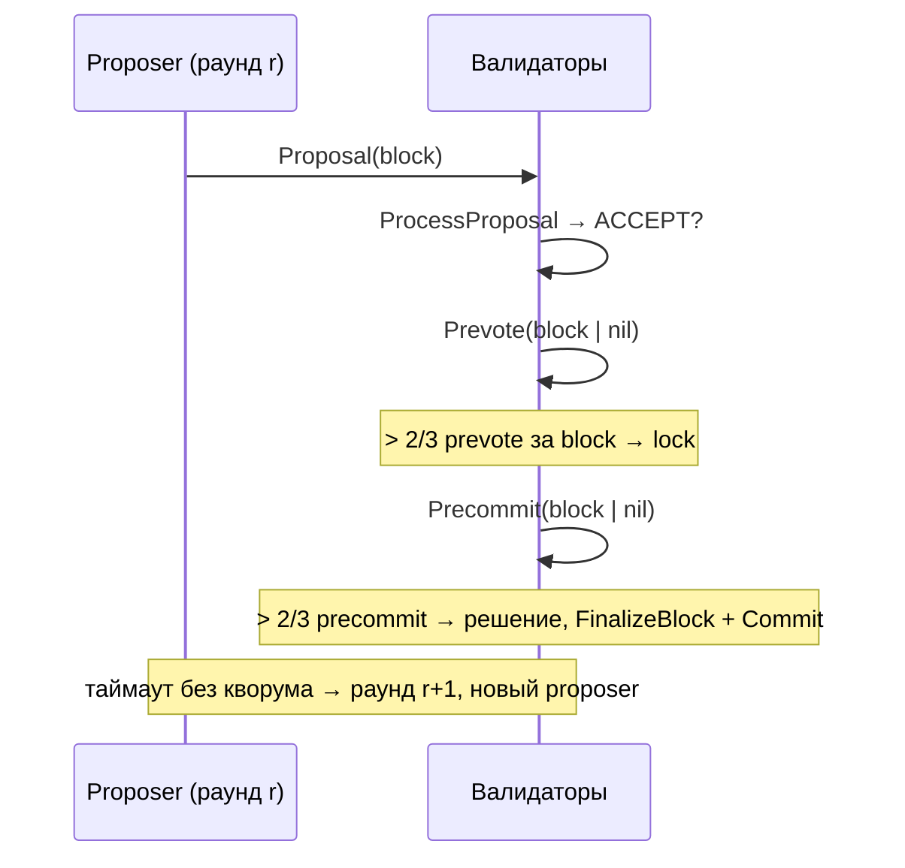
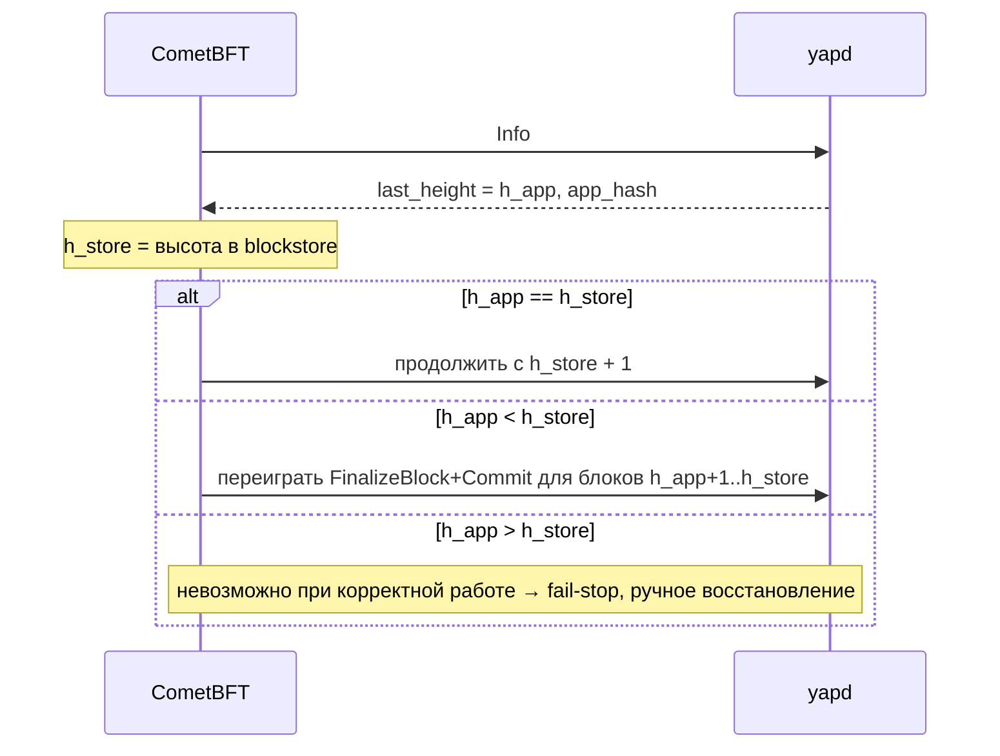

# Консенсус YapChain

Статусы: **DECIDED** — утверждено, **PROPOSED** — предлагается, **OPEN** — требует решения.

## 1. Требования

- **DECIDED**: permissioned BFT, 4 известных валидатора на старте.
- Safety при `f < n/3` византийских по весу голосов; при `n = 4` равного веса — `f = 1`, кворум = 3 голоса.
- Liveness в модели частичной синхронии.
- Мгновенная финальность: решённый блок не откатывается.
- Восстановление после падения без ручного вмешательства и без двойного голосования.
- Синхронизация новых нод с нуля.
- Изменение состава валидаторов (позже, см. §9).
- Интеграция с C++20-ядром без переписывания state machine.

## 2. Рассмотренные варианты

Статус поддержки на ноябрь 2026, где не отмечено иное, требует проверки перед M2.

| Вариант | Язык / интеграция | Зрелость | Плюсы | Минусы |
|---|---|---|---|---|
| **CometBFT** (Tendermint) | Go, отдельный процесс; приложение на любом языке через ABCI++ (socket/gRPC) | Production в десятках сетей Cosmos. Ветка v0.38 ввела ABCI 2.0 (`FinalizeBlock`), v0.39.x вышла весной 2026 | WAL, защита от double-sign, blocksync, statesync, evidence, mempool, P2P, RPC — всё готово; спецификации и формальные модели | Второй язык (Go) в эксплуатации; нет официальной C++-библиотеки ABCI; P2P тоже приходит из CometBFT |
| **Malachite** (Informal Systems) | Rust-библиотека с реализацией Tendermint; встраивание через C ABI-обёртку | По README — pre-alpha; используется в сети Arc (Circle). Версии крейтов 0.5–0.7-pre | Встраиваемая библиотека, современный код, WAL | Нестабильный API, FFI Rust↔C++, меньше эксплуатационного опыта |
| **concord-bft** (VMware) | C++17 | Использовался в VMware Blockchain; признаков активной разработки на 2026 не найдено — **нужна проверка** | Нативный C++ | Тяжёлая сборка, своя модель state transfer, сложно встроить; риск заброшенности |
| **libhotstuff** | C++ | Исследовательский прототип, давно без активной разработки — **нужна проверка** | Простой протокол HotStuff | Нет WAL, синхронизации, эксплуатационной зрелости |
| Raft (NuRaft, etcd-raft) | C++/Go | Зрелые | — | Только crash-fault tolerance, не BFT — **отклонено** |
| BFT-SMaRt | Java | Зрелый, академический | — | JVM, слабая экосистема блокчейн-интеграции |
| Собственная реализация | C++20 | — | Полный контроль, один язык | Месяцы работы, высокий риск ошибок safety, нужно повторить WAL, sync, evidence |

## 3. Решение

### 3.1 Основной вариант — CometBFT через ABCI++ (DECIDED: [ADR-0002](adr/0002-consensus-engine.md), принят в [ADR-0012](adr/0012-owner-decisions-after-m0.md))

Обоснование:
1. Протокол Tendermint формально описан («The latest gossip on BFT consensus», Buchman, Kwon, Milosevic, 2018) и
   много лет работает в production; писать свой BFT нет нужды.
2. ABCI — ровно та граница «консенсус ↔ детерминированная state machine», которая нужна архитектуре:
   C++-ядро остаётся единственным владельцем state и логики.
3. Закрывает сразу консенсус, P2P, mempool, blocksync, evidence и RPC. Без него всё это пришлось бы
   писать самим на C++ — вместе с вероятными ошибками.

Ценой этого становится второй runtime (Go-бинарь) в эксплуатации. Это внешний процесс, а не зависимость сборки C++.

**Проверено в аудите M1.5 ([ADR-0026](adr/0026-cometbft-version.md), [чек-лист](cometbft-compatibility.md)):**
- версия: **CometBFT v0.40.0** (запасная v0.38.26); линия v1.x отозвана;
- кадры ABCI: unsigned varint-префикс длины + protobuf `Request`/`Response` (`tendermint.abci`);
- новые в v0.40 методы `InsertTx`/`ReapTxs` нужны только для app-mempool; используем стандартный;
- готовой поддерживаемой C++-реализации ABCI-сервера нет — пишем свою в M2.

### 3.2 Запасной вариант (PROPOSED)
1. **Malachite** как встроенная библиотека через тонкий Rust-shim с C ABI за тем же интерфейсом `Application`,
   если CometBFT неприемлем (например, если запрещён Go-процесс). Перед выбором проверить стабильность API и лицензию.
2. Крайний вариант — **собственная C++20-реализация алгоритма Tendermint**, без изобретения нового протокола:
   по опубликованному псевдокоду, с WAL, сохранением последнего подписанного (height, round, step) и
   model-based тестами против формальной спецификации. Только при явном отказе от вариантов 1–2.

В обоих случаях state machine, форматы транзакций и state root не меняются — меняется только адаптер.

## 4. Как работает Tendermint-BFT в YapChain

| Свойство | Реализация |
|---|---|
| Кворум | > 2/3 суммарной power. При 4×10 — нужно 30 из 40, т.е. 3 голоса |
| Safety | Блок решён, если > 2/3 power отправили precommit. Два конфликтующих решения требуют ≥ 1/3 эквивокаторов |
| Liveness | При ≥ 3 из 4 онлайн-валидаторах и синхронной сети. При 2 отключённых сеть **останавливается**, но не расходится |
| Quorum certificate | `Commit` = набор отдельных подписей precommit от > 2/3 power (без агрегации; при 4 валидаторах это несущественно). Включается в следующий блок как `LastCommit` и передаётся приложению как `decided_last_commit` (`CommitInfo`: по записи на каждого валидатора набора `H−1` с `BlockIDFlag` Absent/Commit/Nil). На высоте 1 пуст. Используется для наград (protocol.md §9.1, §9.5) |
| Ротация proposer | Взвешенный round-robin CometBFT; при равных весах — по очереди |
| View change | Раунды: при таймауте propose/prevote/precommit валидаторы переходят в раунд `r+1` с новым proposer'ом; блокировки (locked value) сохраняют safety |
| Время блока | BFT time (v0.40.0, без PBTS): взвешенная медиана меток precommit, Nil/Absent пропускаются; первый блок — время genesis |
| Пустые блоки и темп | PROPOSED: `create_empty_blocks = true`, `[consensus] timeout_commit ≈ 2 s` в config.toml (в v0.40.0 консенсус-параметра `next_block_delay` нет), чтобы эмиссия шла предсказуемо (economics.md §4) |

## 5. Хранимое состояние консенсуса

| Что | Где | Кто владеет |
|---|---|---|
| WAL консенсуса (сообщения текущей высоты) | `cometbft/data/cs.wal` | CometBFT |
| Последний подписанный (height, round, step) | `priv_validator_state.json` | CometBFT — главная защита от double-sign после рестарта |
| Блоки и коммиты | blockstore CometBFT | CometBFT |
| Валидаторы, consensus params | state store CometBFT | CometBFT |
| State приложения, `last_height`, `last_state_root` | LMDB `yapd` | YapChain |
| Результаты tx по высотам | LMDB `yapd` | YapChain |

## 6. Восстановление после сбоев

Правила для `yapd` (PROPOSED):
1. `FinalizeBlock` не пишет на диск; все изменения в памяти до `Commit`.
2. `Commit` записывает state, узлы SMT, результаты tx, `last_height`, `last_state_root` **одной транзакцией LMDB**.
   Падение до или во время `Commit` откатывает всю высоту целиком, и CometBFT переиграет блок.
3. Повторное исполнение того же блока над тем же state даёт тот же `state_root` (детерминизм), поэтому replay безопасен.
4. Если после replay `app_hash` не совпадает с заголовком — нода останавливается с диагностикой (state divergence).
5. `ProcessProposal` и `PrepareProposal` работают над временной копией state и ничего не пишут; после рестарта им нечего
   восстанавливать.
6. `InitChain` вызывается только при `h_app = 0` и проверяет совпадение genesis (protocol.md §11.4).

## 7. Синхронизация нод

- **Blocksync** (PROPOSED для testnet): новая нода скачивает блоки и переисполняет их от genesis.
  Даёт полную проверку истории и не требует от `yapd` ничего, кроме обычного исполнения.
- **Statesync** (OPEN, после M5): требует ABCI snapshot-методов и формата снапшотов SMT. Пока не нужен.
- Full node — та же пара `cometbft + yapd` без ключа валидатора. Валидатор = full node + ключ подписи.

## 8. Equivocation и evidence

- CometBFT обнаруживает двойные голоса (`DuplicateVoteEvidence`) и light-client атаки, включает их в блок и передаёт
  в `FinalizeBlock.misbehavior`.
- PROPOSED для testnet: state не меняется (стейкинга и slashing нет); `yapd` порождает событие `validator_misbehavior`,
  оператор сети исключает валидатора вручную (через новый genesis/upgrade до появления административных операций).
- OPEN: автоматически лишать нарушителя доли эмиссии на N эпох — простая мера, если понадобится.

## 9. Состав валидаторов

- PROPOSED: 4 валидатора с одинаковой power = 10, заданы в genesis (`validators` в нашем genesis и в genesis CometBFT
  должны совпадать; это проверяет `yap genesis validate`).
- Разные операторы и хосты: при `n = 4` падение двух нод останавливает сеть.
- Изменение состава: через `validator_updates` в ответе `FinalizeBlock`, инициируемые административной tx
  governance multisig 3-of-5 — **DECIDED**, реализация после M1 ([ADR-0013](adr/0013-governance-multisig.md)).
  Обновление `ValidatorInfo` в state и `validator_updates` должны происходить в одном блоке; CometBFT применяет
  новый набор с задержкой (на высоте `H+2`), и правило сверки `last_commit` (protocol.md §9.1) будет уточнено в той же
  ревизии протокола.
- Consensus-ключи — файловые (`priv_validator_key.json`) на testnet; удалённый signer (tmkms/Horcrux) — OPEN для mainnet.

## 10. P2P

**DECIDED**: транспорт, gossip и обнаружение пиров — CometBFT ([ADR-0009](adr/0009-p2p-via-cometbft.md), [ADR-0012](adr/0012-owner-decisions-after-m0.md)).
Конфигурация testnet (PROPOSED): валидаторы связаны `persistent_peers` полносвязно, `pex = false` на валидаторах,
публичные full nodes с `pex = true` как seed/RPC-точки; опционально — sentry-ноды перед валидаторами.
