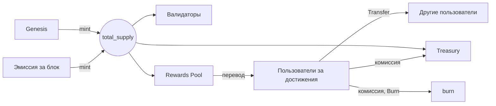

# Экономика YAP (закрытый testnet)

Статусы: **DECIDED** — утверждено, **PROPOSED** — предлагается, **OPEN** — требует решения.
Все числа ниже — **DECIDED ТОЛЬКО ДЛЯ TESTNET** ([ADR-0012](adr/0012-owner-decisions-after-m0.md)).
Mainnet-экономика — отдельное решение (OPEN); ни одно число этого документа не переносится в mainnet автоматически.

## 1. Принципы

1. **DECIDED**: новые YAP возникают только из двух источников — genesis и блочной эмиссии.
2. Все прочие движения (переводы, комиссии, награды за достижения, расходы Treasury) — **переводы существующих
   средств**, они не меняют `total_minted`.
3. Уничтожение (burn) уменьшает `total_supply` и учитывается в `total_burned`.
4. Произвольного mint для пользователей, эмитентов и администраторов нет.
5. Все суммы — целые числа в минимальных единицах, дробей и плавающей точки нет.

## 2. Деноминация

| Единица | Значение |
|---|---|
| `yip` | минимальная неделимая единица, хранится как `u64` |
| `YAP` | 1 YAP = 1 000 000 yip (6 знаков после запятой) |

Максимум `u64` ≈ 1.8 × 10¹⁹ yip ≈ 1.8 × 10¹³ YAP — с запасом на 4 порядка выше лимита эмиссии,
так что балансы и supply не могут переполниться при соблюдении `max_issuance`.

## 3. Genesis-распределение

| Получатель | YAP | yip | Тип аккаунта |
|---|---|---|---|
| Treasury | 80 000 000 | 80 000 000 000 000 | системный, без ключа |
| Rewards Pool | 60 000 000 | 60 000 000 000 000 | системный, без ключа |
| Faucet testnet | 50 000 000 | 50 000 000 000 000 | обычный аккаунт, ключ у команды |
| Операторы валидаторов (4 × 2 500 000) | 10 000 000 | 10 000 000 000 000 | обычные аккаунты |
| **Итого** | **200 000 000** | **200 000 000 000 000** | |

## 4. Эмиссия за блок

Нормативный алгоритм — [protocol.md §9.5](protocol.md#95-эмиссия-нормативно); здесь — его смысл.
Выполняется в конце каждого блока, после всех транзакций.

- `reward = min(block_reward, max_issuance − total_minted)` делится: 60% валидаторам, 30% Rewards Pool,
  10% Treasury (доли `floor`, остаток — Treasury).
- Валидаторская доля делится **пропорционально power** между валидаторами, чей голос за **предыдущий** блок включён в
  `last_commit` с флагом `Commit` ([ADR-0015](adr/0015-validator-rewards-last-commit.md)). Голоса `Nil` и `Absent`
  наград не получают. Остаток от деления — Treasury.
- Начисление идёт на `reward_account` из реестра валидаторов, а не на консенсусный ключ.
  Обычные full nodes наград не получают и не нуждаются в них для работы.
- **Высота 1**: в CometBFT `last_commit` первого блока пуст (предыдущего блока нет), поэтому вся валидаторская доля
  высоты 1 уходит в Treasury. Начиная с высоты 2 блок `H` вознаграждает подписавших блок `H−1`. Dev-режим M1
  повторяет это поведение.
- Состав `last_commit` выбирает proposer (> 2/3 power плюс успевшие голоса), поэтому византийский proposer может
  не включить чужую подпись и лишить валидатора награды за один блок. Для testnet это приемлемо (threat-model.md №15).
- Нулевые доли (например, `share_i = 0` при крошечной награде) ничего не зачисляют и не создают аккаунтов
  (protocol.md §9.3, ADR-0021).
- После достижения `max_issuance` эмиссия прекращается навсегда (`reward = 0`), даже если часть YAP сожжена:
  лимит действует на **накопленную эмиссию** (`total_minted`), а не на текущий supply.

Пример (power 4 × 10, все подписали): `reward = 2 000 000`; `v = 1 200 000`, каждому валидатору 300 000;
`p = 600 000`; `t = 200 000`.
Пример (подписали 3 из 4): каждому из трёх `floor(1 200 000 × 10 / 30) = 400 000`, остаток 0.
Пример (высота 1): валидаторам 0, Treasury `200 000 + 1 200 000 = 1 400 000`, пул 600 000.

Темп: при 2 YAP за блок и блоке ≈ 2 с — ≈ 31.5 млн YAP в год; до лимита 1 млрд ≈ 25 лет.
Эмиссия привязана к числу блоков, а не ко времени, поэтому темп зависит от параметров времени блока CometBFT
(consensus.md §4).

## 5. Комиссии

- Минимальная комиссия `min_fee = 1 000 yip` (0.001 YAP) за транзакцию любого типа; можно заплатить больше,
  но приоритета это не даёт.
- Распределение: `burn_part = floor(fee × fee_burn_bps / 10000)` сжигается, остаток → Treasury.
  При `fee_burn_bps = 5000` — половина.
- Невалидная транзакция комиссию не платит: она либо не попадает в блок (`CheckTx`, `ProcessProposal`), либо
  пропускается без изменения state (protocol.md §7.5, §10).
- Для `ClaimAchievement` комиссию можно оплатить из получаемой награды (attestations.md §4.3), чтобы новый
  пользователь с нулевым балансом мог получить свою первую награду.

Зачем комиссии в закрытом testnet: защита от спама (каждая tx стоит денег) и проверка всей бухгалтерской цепочки
до mainnet.

## 6. Treasury и Rewards Pool

| Аккаунт | Пополнение | Расход |
|---|---|---|
| Treasury | genesis, 10% эмиссии, остатки делений, 50% комиссий, валидаторская доля высоты 1, добровольные переводы | **DECIDED**: расходы только операцией governance multisig 3-of-5 ([ADR-0013](adr/0013-governance-multisig.md)), реализуется после M1; до этого расходов нет |
| Rewards Pool | genesis, 30% эмиссии, добровольные переводы | только награды за достижения по правилам attestations.md |

Если пул пуст, claim'ы отклоняются (`ERR_CLAIM_POOL_EMPTY`) до следующих поступлений; новые YAP ради наград
не создаются.

## 7. Burn

- Пользовательская операция `Burn {amount}` — сжечь свои YAP («экономика настоящая, ценность сомнительная»).
- Сжигание части комиссий.
- Сожжённые YAP не возвращаются: `total_burned` только растёт, `max_issuance` не пополняется.

## 8. Сводка параметров testnet

| Параметр | Значение | Смысл |
|---|---|---|
| `min_fee` | 1 000 yip | 0.001 YAP |
| `fee_burn_bps` | 5 000 | 50% комиссии сжигается |
| `block_reward` | 2 000 000 yip | 2 YAP за блок |
| `reward_validators_bps` | 6 000 | 60% валидаторам |
| `reward_pool_bps` | 3 000 | 30% в Rewards Pool |
| `reward_treasury_bps` | 1 000 | 10% в Treasury |
| `max_issuance` | 1 000 000 000 000 000 yip | 1 млрд YAP включая genesis |
| `max_tx_bytes` | 4 096 | |
| `max_memo_bytes` | 128 | |
| `max_tx_ttl_blocks` | 1 800 | ≈ 1 час |
| `epoch_length_blocks` | 43 200 | ≈ 1 сутки |
| `max_attestation_validity_s` | 604 800 | 7 суток |
| `attestation_clock_skew_s` | 300 | 5 минут |
| `max_claims_per_subject_per_epoch` | 20 | |

## 9. Открытые вопросы

- OPEN: экономика mainnet; правила переноса балансов testnet (предлагается: не переносить).
- OPEN (экономический аудит, M2.5): распределять ли долю валидаторов относительно **полного** voting power набора,
  а не только подписавшего power — см. §10. Текущее правило создаёт у proposer'а стимул включать в LastCommit ровно
  кворум.
- Решено: числа testnet (ADR-0012), управление Treasury — multisig 3-of-5 после M1 (ADR-0013).

## 10. Наблюдения M2.5 (живая сеть из 4 валидаторов, без изменения токеномики)

Источники — живые тесты M2.5 (`tests/integration/test_live_faults.py`, `test_live_soak.py`); 4 валидатора по
power 10, loopback, задержки — через прокси netfault. Правило наград не менялось (ADR-0015, §4).

**NIL и ABSENT при разных условиях связи** (доля флагов в `decided_last_commit`, A/C/N за профиль из 11 высот на
валидатора):

| Условия | v0 | v1 | v2 | v3 |
|---|---|---|---|---|
| без отказов, задержки 50–300 мс, jitter (по 11 высот) | 0/11/0 | 0/11/0 | 0/11/0 | 0/11/0 |
| разрывы 1 с каждые 10 с | 0/10/1 | 0/11/0 | 0/9/2 | 1/10/0 |
| разрывы 2 с каждые 6 с (8 блоков) | 0/7/0 | 0/7/0 | 0/7/0 | 0/6/1 |
| soak: 1001 высота, 9 отказов (A/C/N) | 12/987/3 | 0/981/21 | 13/969/20 | 13/976/13 |
| M2.4, 5 прогонов без отказов | NIL 3–7 за прогон из ~190 голосов (порядок доставки голосов) | | | |

Доля потерянных голосов в soak — 1,5–3,3 % на валидатора (ABSENT — при остановках/разделениях, NIL — при обрывах и
из-за порядка доставки голосов); без отказов на loopback — 0–2 %.

**Распределение наград (soak).** Награды валидаторов за 1002 высоты soak (seed 20261124), фактически по текущему правилу и — для сравнения — если
бы доля делилась относительно полного power (300 000 yip за каждый COMMIT, остальное в Treasury):

| Валидатор | COMMIT | Получено (подписавший power) | При полном power | Разница |
|---|---|---|---|---|
| v0 | 987 | 304,1 YAP | 296,1 YAP | +8,0 |
| v1 | 981 | 301,7 YAP | 294,3 YAP | +7,4 |
| v2 | 969 | 296,9 YAP | 290,7 YAP | +6,2 |
| v3 | 976 | 299,7 YAP | 292,8 YAP | +6,9 |

Сейчас вся доля валидаторов (1 202,4 YAP) уходит подписавшим; при полном power им досталось бы 1 173,9 YAP, а
28,5 YAP — в Treasury. Разница — это доля пропустивших голос, перераспределённая между остальными.

**Исключение подписей сверх кворума.** CometBFT принимает блок, если его LastCommit содержит подписи > 2/3 power
(`VerifyCommit`); какие подписи сверх этого включить, решает proposer. Текущее правило делит всю долю валидаторов
`v` между **подписавшими** пропорционально power: `share_i = floor(v × power_i / W_signed)`.

| Состав LastCommit (4 × power 10) | Доля каждого подписанта | Не подписавшие | Treasury от `v` |
|---|---|---|---|
| все 4 | 300 000 yip | — | 0 |
| 3 (одна подпись исключена) | 400 000 yip (+33 %) | 0 | 0 |

**Потенциальный стимул уменьшать число подписантов.** Proposer, который включает ровно кворум (себя и двух
других), увеличивает свою награду за этот блок с 300 000 до 400 000 yip и лишает награды исключённого. При
ротации (1/4 блоков — свои) это +8,3 % к его доходу валидатора, не нарушая протокол CometBFT; честный
исключённый валидатор теряет 1/4 дохода за каждый такой блок. Тот же перенос происходит и без умысла: NIL из-за
порядка доставки голосов (M2.4) и ABSENT при обрывах связи перераспределяют долю пострадавшего между остальными.
Это сильнее, чем оценка угрозы №15 в threat-model.md («ущерб — доля одного блока»): там учтён ущерб, но не выгода
proposer'а.

**Открытый вопрос для экономического аудита** (OPEN, токеномика в M2.5 не менялась): распределять ли долю валидаторов
**относительно полного voting power набора** (`share_i = floor(v × power_i / W_total)` для подписавших; доля
не подписавших — в Treasury или Rewards Pool) вместо подписавшего power. Плюсы: исключение чужой подписи ничего не
даёт proposer'у; награда честного валидатора не зависит от поведения других. Минусы и вопросы: валидатор с плохой
связью теряет столько же, сколько сейчас, но Treasury растёт за счёт пропусков; нужен ли порог (например, награда
только при ≥ 2/3 power подписей, что всегда так); как это сочетается с будущим slashing и governance; изменение —
консенсусное (protocol.md §9.5), требует отдельного ADR, новых векторов и миграции на новой сети.
