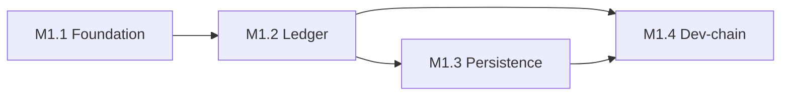

# Roadmap YapChain

Статусы: **DECIDED** — утверждено, **PROPOSED** — предлагается, **OPEN** — требует решения.

| Этап | Содержание | Статус |
|---|---|---|
| **M0** | Архитектура, протокол, консенсус, экономика, аттестации, модель угроз, ADR; ревизия r2 | завершён |
| **M1** | Детерминированное ядро без сети и BFT; разбит на M1.1–M1.4 (ниже) | M1.1–M1.4 — завершены; приёмка M1 |
| **M1.5** | Независимый аудит ядра, исправления, выбор CometBFT v0.40.0, чек-лист M2 ([audit-m1.5.md](audit-m1.5.md)) | завершён |
| **M2** | ABCI++ адаптер, CometBFT v0.40.0 localnet 1 → 4 валидатора (docker compose), crash recovery, blocksync | PROPOSED |
| **M3** | Аттестации: реестр, каталог, `ClaimAchievement`, лимиты, SDK подписи для эмитентов | PROPOSED |
| **M4** | Governance multisig 3-of-5: формат, операции реестра, валидаторов, параметров, Treasury | DECIDED (ADR-0013), после M1 |
| **M5** | Закрытый testnet: 4 валидатора у разных операторов, full nodes, faucet, мониторинг, runbook | PROPOSED |
| **M6** | Explorer, веб-кошелёк, HTTP/JSON-шлюз (если CometBFT RPC + `abci_query` недостаточно) | PROPOSED |
| **M7** | Интеграция приложений (Мемпаспорт, Мемонатор, Yapped) | PROPOSED |

M2 и M3 независимы: аттестации — чистая state machine и не зависят от консенсуса.

---

## M1 — общие правила

- Без P2P, BFT, ABCI, RPC-сервера.
- Любая функциональность, которая ещё не реализована, отсутствует или явно возвращает ошибку
  (`ERR_UNSUPPORTED`, исключение «not implemented» в CLI). Заглушек, имитирующих успех, нет.
- Платформы: Linux x86_64 и aarch64; компиляторы GCC ≥ 13 и Clang ≥ 17; C++20; `-Werror`.
- Каждый этап приносит независимые test vectors из `tools/refgen` (Python, без libsodium и без кода ядра).

---

## M1.1 — Foundation

**Scope.** Сборка, зависимости, базовые типы, YCS, хеши, Ed25519, Bech32m и адреса.

**Зависимости.** Нет (первый этап). Нормативная база — protocol.md r2 §1, §3, §4, §5.1–5.4.

**Deliverables.**
- CMake-проект, presets (`debug`, `release`, `asan`), строгие предупреждения, `LICENSE` (Apache-2.0).
- `cmake/Dependencies.cmake`: libsodium 1.0.22, Catch2 3.16.1, nlohmann/json 3.12.0 — URL + SHA-256 (ADR-0018).
- `yap_common`: `Bytes`, `Hash32`, `Result`, hex, checked-арифметика `u64`, `mul_div_floor`.
- `yap_codec`: YCS `Writer`/`Reader` со строгим декодированием и лимитами.
- `yap_crypto`: SHA-256, SHA-512 (через libsodium), `H_tag`, Ed25519 keygen/sign/verify, Bech32m, адреса
  (`account_id`, системные аккаунты, кодирование и разбор).
- `tools/refgen`: независимый генератор векторов; `test-vectors/*.json`.
- Unit-тесты и тесты векторов; fuzz-цели для YCS и Bech32m (Clang).
- CI (GitHub Actions): GCC и Clang × x86_64 и aarch64 × Debug/Release/ASan+UBSan; проверка, что векторы
  воспроизводятся генератором.

**Тесты.**
- YCS: все примитивы, round-trip, отказы (лишние байты, короткий вход, bool = 2, option-тег = 2, длина > лимита,
  длина > остатка, огромный `vec` без аллокации).
- Checked-арифметика: границы `0`, `U64_MAX`, `mul_div_floor` с 128-битным произведением.
- SHA-256: векторы NIST; `H_tag` для всех тегов реестра.
- Ed25519: RFC 8032 §7.1 (тесты 1–3), детерминизм подписи, граничные векторы ADR-0014.
- Bech32m: векторы BIP-350 (валидные/невалидные), Bech32-строки отклоняются, адреса из фиксированных seed'ов,
  смешанный регистр, неверный HRP, неверная версия, ненулевой padding, неверная длина.

**Критерии приёмки.**
1. Сборка и все тесты зелёные на GCC в Debug, Release и ASan+UBSan локально; на GCC и Clang × x86_64 и aarch64 — в CI.
2. Все векторы `test-vectors/` проходят; `tools/refgen` воспроизводит их побайтно.
3. Граничные векторы Ed25519 совпадают с поведением libsodium 1.0.22.
4. Нет предупреждений при `-Wall -Wextra -Wpedantic -Wconversion -Wsign-conversion -Werror`.

## M1.2 — Ledger

**Статус:** завершён (protocol.md r4). Отклонения от плана: распределение комиссии реализовано вместе с ledger
(без него транзакция не может быть атомарной и сохранять supply-инвариант); `commit()` в M1.2 применяет блок к
хранилищу в памяти, M1.3 делает его долговечным.

**Scope.** Транзакции и state machine в памяти: исполнение блока целиком по protocol.md §9, без диска.

**Зависимости.** M1.1.

**Deliverables.**
- `yap_tx`: `TxBody`, `SignedTx`, `Transfer`, `Burn`, `ClaimAchievement` (декодирование), `tx_id`, stateless S1–S11.
- `yap_merkle`: SMT (§8.1) в памяти, RFC 6962 root (§8.2).
- `yap_state`: типы state §7, `MemoryKvStore`, overlay блока и overlay транзакции (§7.5), stateful T1–T6
  (T7 → `ERR_UNSUPPORTED`), эффекты, комиссии, эмиссия §9.5, инварианты §7.3.
- `yap_chain`: `Genesis` (строгий JSON → YCS, правила §11.2 — ключи валидаторов через уже реализованную
  `is_valid_validator_public_key()`, §5.7; `genesis_hash`, начальный state), `BlockContext`,
  `Application::init_chain/check_tx/prepare_proposal/process_proposal/finalize_block` над памятью.
- Независимая эталонная реализация исполнения в `tools/refgen` (Python) для генерации `blocks.json`.

**Тесты.** Векторы `tx.json`, `smt.json`, `merkle_list.json`, `genesis.json`, `blocks.json`; по тесту на каждое правило
S1–S11 и T1–T6 с ожидаемым кодом, включая порядок при нескольких нарушениях; nonce (цепочки, пропуски, повтор,
нулевой баланс с `nonce > 0`); недостаточный баланс (ровно хватает / не хватает на 1 / две tx вместе); экономика
(эмиссия на высоте 1 и 2+, неполный `last_commit`, остатки делений, достижение `max_issuance`, burn); атомарность
(ошибка в середине эффектов не оставляет следов); property-тест SMT (порядок вставки не влияет на root);
согласованность `process_proposal` ↔ `finalize_block`.

**Критерии приёмки.** Все векторы проходят; инварианты выполняются после каждого блока сценариев;
`process_proposal = ACCEPT` ⇒ все коды `OK` в `finalize_block`; fail-stop-ситуации покрыты тестами.

## M1.3 — Persistence

**Статус:** завершён (ADR-0022, ADR-0023). Хранилище — LMDB 0.9.36; персистентный SMT с инкрементальным
обновлением; атомарный commit высоты; проверки при старте, `verify_state`, replay из внешнего тестового журнала;
crash-тесты с SIGKILL в дочернем процессе. CLI `verify-state` — в M1.4 (сейчас — функция `chain::verify_state`).

**Scope.** Хранение state на диске и восстановление.

**Зависимости.** M1.2.

**Deliverables.** `KvStore` поверх LMDB (зависимость по ADR-0018), хранение листьев и узлов SMT, метаданные
`last_height/last_state_root`, результаты tx по высотам; `Application::commit/info/query`; `verify-state`
(пересчёт root из листьев, проверка узлов по хешу); fault injection в слое хранилища.

**Тесты.** Commit → закрыть → открыть → идентичный state; SIGKILL во время `commit` (в дочернем процессе) → откат к
предыдущей высоте; повторный `finalize_block` после рестарта даёт тот же root; искусственная порча узла/листа
обнаруживается `verify-state`; `map_size` исчерпан → fail-stop, а не порча.

**Критерии приёмки.** 100 % сценариев crash-recovery проходят в ASan-сборке; состояние после рестарта побайтно
совпадает с состоянием до него.

## M1.4 — Dev-chain

**Статус:** завершён (ADR-0024, ADR-0025). CLI `yap`: `keys`, `addr`, `tx`, `genesis`, `dev`, `query`,
`verify-state`; E2E-сценарий из 17 шагов только через бинарник.

**Scope.** Dev-блоки, CLI, длинные сценарии и кросс-компиляторная проверка детерминизма.

**Зависимости.** M1.2, M1.3.

**Deliverables.** `consensus/dev`: производство, подпись, импорт, replay `DevBlock` (protocol.md §14); keystore
(protocol.md §5.6); CLI `yap`: `keys`, `addr`, `tx build/sign/inspect`, `genesis validate/hash`,
`dev produce/replay/state-root`, локальный `query`; генератор сценариев; fuzz-цели `fuzz_signed_tx_decode`,
`fuzz_devblock_import`, `fuzz_execute_block`.

**Тесты.** Каждый вид невалидного dev-блока отклоняется без изменения state; сценарий ≥ 1 000 блоков и ≥ 10 000 tx;
replay в пустую БД; перезапуски на случайных высотах; keystore (неверный пароль, порча файла).

**Критерии приёмки (= критерии всего M1).**
1. Сценарий даёт побитно одинаковые roots на каждой высоте: при повторе, GCC vs Clang, Debug vs Release,
   x86_64 vs aarch64 (сравнение артефактов CI), с перезапусками.
2. Инварианты §7.3 после каждого блока.
3. Fuzz-цели ≥ 10 минут каждая без падений и утечек.
4. Невалидный dev-блок любого типа отклоняется, state не меняется.
